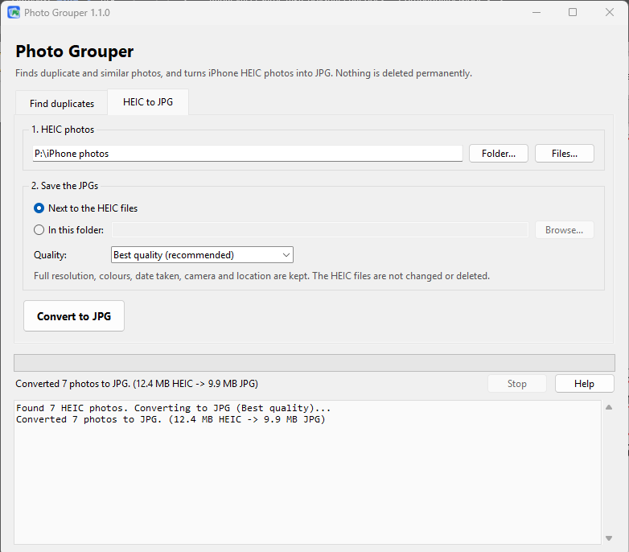

<p align="center"></p>

<h1 align="center">Photo Grouper</h1>

<p align="center">Find duplicate and similar photos on Windows, and turn iPhone HEIC photos into JPG.<br>
Nothing is deleted permanently, and every move can be undone.</p>

---

Photo Grouper does two jobs:

- **[Find duplicates](#find-duplicates)**: sorts each set of copies into its own folder, so you can keep the best one
- **[HEIC to JPG](#heic-to-jpg)**: converts iPhone photos to JPG at full quality, keeping the date taken, location and colours

## Find duplicates

Regular duplicate finders mostly catch exact copies. Photo Grouper also catches:

- **Resized or recompressed copies**, such as a photo that went through WhatsApp or Messenger
- **Rotated or mirrored copies**
- **Photos that look the same**, using an AI model: burst shots, crops, filtered versions and screenshots of a photo

Each set goes into `_similar_groups\group_001`, `group_002`, … inside your folder. The best copy (highest resolution) gets a `KEEP_` prefix, so you can quickly decide what to delete.

<p align="center"></p>

### How to use

1. **Browse**: pick the folder with your photos. Subfolders are included.
2. **Scan**: nothing is moved yet. A report opens in your browser with every group side by side.
3. **Move into group folders**: once the report looks right, this moves each set into its own folder.
4. Go through the group folders, then press **Recycle extra copies**: in every group folder, each photo whose name does not start with `KEEP_` goes to the Windows Recycle Bin. To keep one of them too, rename it so it starts with `KEEP_` first. A group with no `KEEP_` photo is left alone. You can also delete the copies yourself instead.
5. **Undo**: puts every moved photo back where it was, with its original name. Photos sent to the Recycle Bin can be restored from there.

The report shows each group side by side. The best copy has a green border:

<p align="center"></p>

### Settings

| Setting | When to use |
|---|---|
| **Normal** | Good for most folders |
| **Strict** | Groups contain photos that are not really the same |
| **Loose** | You want to catch more, such as burst shots. Check the report carefully before moving |
| **AI option** | Catches photos that *look* the same. The first time, it downloads an ~89 MB model. Untick it for a faster, offline scan that finds exact, resized and rotated copies only |

Scanning the same folder again is fast, because results are remembered.

## HEIC to JPG

iPhones save photos as HEIC, which many Windows programs, websites and older phones cannot open. The **HEIC to JPG** tab converts them:

1. Pick a folder (subfolders are included) or choose the HEIC files.
2. Choose where the JPGs go: next to the HEIC files, or into one folder (the subfolders are kept).
3. Press **Convert to JPG**.

<p align="center"></p>

What is kept:

- **Quality**: full resolution and full colour detail (JPEG quality 95, no colour subsampling). The JPG looks the same as the HEIC
- **Colours**: the colour profile (for example the iPhone's Display P3), so colours don't look washed out
- **Photo info**: date taken, camera, location and other EXIF/XMP data, so the photos still sort by date
- **Orientation**: portrait photos stay upright
- **File dates**: the JPG gets the same modified and created dates as the HEIC

The HEIC files are never changed or deleted, and an existing JPG is never overwritten. If you convert the same folder again, photos that already have a JPG are skipped.

| Quality | When to use |
|---|---|
| **Best** (recommended) | Looks the same as the HEIC |
| **Maximum** | Even closer to the original, bigger files |
| **Smaller files** | Still very good, for sharing or when space is tight |

JPG files are often bigger than HEIC, because JPG is an older, less efficient format.

## Download

1. Go to the [**Releases**](../../releases/latest) page and download `PhotoGrouper.exe`.
2. Double-click it. No installation and no Python are needed.

> **"Windows protected your PC"?** Click **More info**, then **Run anyway**. Windows shows this for new apps that are not signed by a large publisher.

## Troubleshooting

The app has a **Help** button with these answers too.

| Problem | Fix |
|---|---|
| Antivirus blocks `PhotoGrouper.exe` | A common false alarm for small unsigned tools. Add an exception, or build it yourself from source (below) |
| App takes a few seconds to open | Normal. The single `.exe` unpacks itself on every start |
| "Could not download the AI model" | Check your internet. Some office networks and VPNs block `huggingface.co`. You can untick AI and still scan |
| "Cannot write inside this folder" | The folder is read-only (CD, protected USB drive, some network or cloud folders). Copy the photos to a local folder first |
| Some files "could not be read" | They are listed at the bottom of the report and left where they are. Usually damaged files or unsupported RAW variants |
| Photos "skipped" while moving | They were open in another program. Close it, then Scan and Move again |
| "Recycle extra copies" refused | The folder is on a USB, memory-card or network drive. Windows has no Recycle Bin there, so the photos would be deleted for good. Delete them by hand if you are sure |
| A HEIC "could not be converted" | Usually a damaged file. The reason is shown in the log box |

## Privacy

Everything runs on your own computer, including the HEIC conversion. Photos are never uploaded. The only network access is the one-time download of the AI model from Hugging Face.

Files the app creates:
- `<your folder>\_photo_grouper\`: report and scan cache
- `<your folder>\_similar_groups\`: the group folders, after you press Move
- `%LOCALAPPDATA%\PhotoGrouper\`: the AI model
- The JPGs, wherever you chose to save them

To remove the app completely, delete `PhotoGrouper.exe` and these folders.

## How it works

1. **Exact copies**: MD5 hash of the file bytes.
2. **Edited copies**: a 64-bit DCT perceptual hash, compared across all 8 rotations and mirror images, so rotated and flipped copies still match.
3. **Look-alikes** (optional): image embeddings from OpenAI's CLIP ViT-B/32, run locally with ONNX Runtime and compared by cosine similarity. Very large chains are split by raising the threshold step by step.

Matches are joined into groups with union-find.

HEIC files are decoded with [pillow-heif](https://github.com/bigcat88/pillow_heif) (libheif). The image is turned upright, then saved as JPEG at quality 95 with 4:4:4 chroma, together with the original EXIF (orientation reset to normal), XMP and ICC profile. Conversion runs on all CPU cores.

## Build from source

You need Windows and Python 3.11–3.13.

```bat
git clone https://github.com/Nahid-Rahman/PhotoGrouper.git
cd PhotoGrouper
build_exe.bat
```

`build_exe.bat` creates a virtual environment, installs the dependencies and builds `PhotoGrouper.exe` with PyInstaller.

To run without building:

```bat
pip install -r requirements.txt -r requirements-optional.txt
python src\photo_grouper.py
```

### Tests

```bat
pip install pytest -r requirements.txt
python -m pytest tests
```

The tests create their own photos and HEIC files, so they need no internet and no real photos. They check the duplicate finder, Move/Undo, Recycle extra copies, and the HEIC conversion (including image quality, EXIF, colour profile and orientation). GitHub Actions runs them on every push to `main` and on pull requests (see `.github/workflows/tests.yml`).

### Releases

GitHub Actions builds the `.exe` on Windows (see `.github/workflows/build.yml`). To publish a new version:

1. Update `__version__` in `src/grouper_core.py`, for example to `1.1.0`.
2. Push a tag with the same version:

   ```bat
   git tag v1.1.0
   git push origin v1.1.0
   ```

The workflow runs the tests, builds `PhotoGrouper.exe` and attaches it to a new release. If the tag and `__version__` don't match, the build stops with an error, so a release can never show the wrong version. You can also run the workflow manually from the **Actions** tab (this builds the `.exe` without making a release).

## Credits

- [CLIP](https://github.com/openai/CLIP) by OpenAI, with the ONNX export by [Xenova](https://huggingface.co/Xenova/clip-vit-base-patch32)
- [Pillow](https://python-pillow.org/), [pillow-heif](https://github.com/bigcat88/pillow_heif), [rawpy](https://github.com/letmaik/rawpy), [ONNX Runtime](https://onnxruntime.ai/), [PyInstaller](https://pyinstaller.org/)

## License

[MIT](LICENSE)
