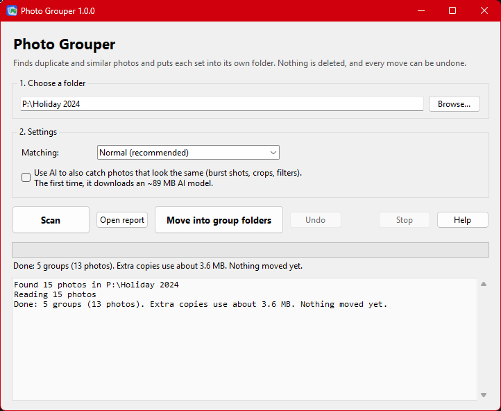
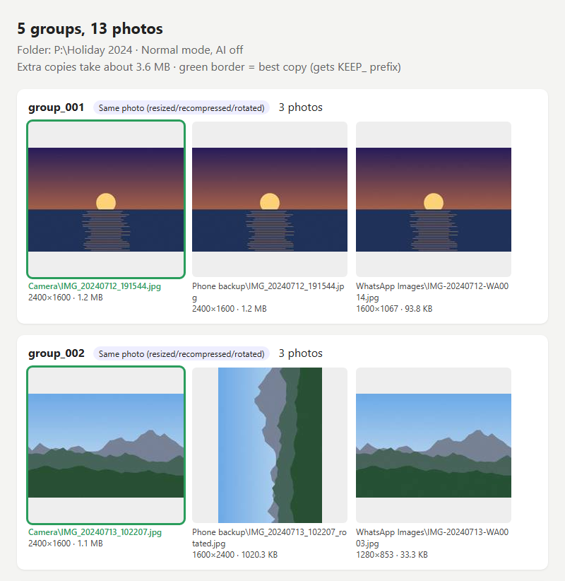

<p align="center"></p>

<h1 align="center">Photo Grouper</h1>

<p align="center">Find duplicate and similar photos on Windows and sort each set into its own folder.<br>
Nothing is ever deleted, and every move can be undone.</p>

---

Regular duplicate finders mostly catch exact copies. Photo Grouper also catches:

- **Resized or recompressed copies**, such as a photo that went through WhatsApp or Messenger
- **Rotated or mirrored copies**
- **Photos that look the same**, using an AI model: burst shots, crops, filtered versions and screenshots of a photo

Each set goes into `_similar_groups\group_001`, `group_002`, … inside your folder. The best copy (highest resolution) gets a `KEEP_` prefix, so you can quickly decide what to delete.

<p align="center"></p>

## Download

1. Go to the [**Releases**](../../releases/latest) page and download `PhotoGrouper.exe`.
2. Double-click it. No installation and no Python are needed.

> **"Windows protected your PC"?** Click **More info**, then **Run anyway**. Windows shows this for new apps that are not signed by a large publisher.

## How to use

1. **Browse**: pick the folder with your photos. Subfolders are included.
2. **Scan**: nothing is moved yet. A report opens in your browser with every group side by side.
3. **Move into group folders**: once the report looks right, this moves each set into its own folder.
4. Go through the group folders and delete the copies you don't want. Photo Grouper never deletes anything itself.
5. **Undo**: puts every photo back where it was, with its original name.

The report shows each group side by side. The best copy has a green border:

<p align="center"></p>

### Settings

| Setting | When to use |
|---|---|
| **Normal** | Good for most folders |
| **Strict** | Groups contain photos that are not really the same |
| **Loose** | You want to catch more, such as burst shots. Check the report carefully before moving |
| **AI option** | Catches photos that *look* the same. The first time, it downloads an ~89 MB model. Untick it for a faster, offline scan that finds exact, resized and rotated copies only |

Scanning the same folder again is fast, because results are remembered.

## Troubleshooting

The app has a **Help** button with these answers too.

| Problem | Fix |
|---|---|
| Antivirus blocks `PhotoGrouper.exe` | A common false alarm for small unsigned tools. Add an exception, or build it yourself from source (below) |
| App takes a few seconds to open | Normal. The single `.exe` unpacks itself on every start |
| "Could not download the AI model" | Check your internet. Some office networks and VPNs block `huggingface.co`. You can untick AI and still scan |
| "Cannot write inside this folder" | The folder is read-only (CD, protected USB drive, some network or cloud folders). Copy the photos to a local folder first |
| Some files "could not be read" | They are listed at the bottom of the report and left where they are. Usually damaged files or unsupported RAW variants |
| Photos "skipped" while moving | They were open in another program. Close it, then Scan and Move again |

## Privacy

Everything runs on your own computer. Photos are never uploaded. The only network access is the one-time download of the AI model from Hugging Face.

Files the app creates:
- `<your folder>\_photo_grouper\`: report and scan cache
- `<your folder>\_similar_groups\`: the group folders, after you press Move
- `%LOCALAPPDATA%\PhotoGrouper\`: the AI model

To remove the app completely, delete `PhotoGrouper.exe` and these folders.

## How it works

1. **Exact copies**: MD5 hash of the file bytes.
2. **Edited copies**: a 64-bit DCT perceptual hash, compared across all 8 rotations and mirror images, so rotated and flipped copies still match.
3. **Look-alikes** (optional): image embeddings from OpenAI's CLIP ViT-B/32, run locally with ONNX Runtime and compared by cosine similarity. Very large chains are split by raising the threshold step by step.

Matches are joined into groups with union-find.

## Build from source

You need Windows and Python 3.11–3.13.

```bat
git clone https://github.com/<your-username>/PhotoGrouper.git
cd PhotoGrouper
build_exe.bat
```

`build_exe.bat` creates a virtual environment, installs the dependencies and builds `PhotoGrouper.exe` with PyInstaller.

To run without building:

```bat
pip install -r requirements.txt -r requirements-optional.txt
python src\photo_grouper.py
```

### Releases

GitHub Actions builds the `.exe` on Windows (see `.github/workflows/build.yml`). To publish a new version:

1. Update `__version__` in `src/grouper_core.py`.
2. Push a tag:

   ```bat
   git tag v1.0.0
   git push origin v1.0.0
   ```

The workflow builds `PhotoGrouper.exe` and attaches it to a new release. You can also run it manually from the **Actions** tab.

## Credits

- [CLIP](https://github.com/openai/CLIP) by OpenAI, with the ONNX export by [Xenova](https://huggingface.co/Xenova/clip-vit-base-patch32)
- [Pillow](https://python-pillow.org/), [pillow-heif](https://github.com/bigcat88/pillow_heif), [rawpy](https://github.com/letmaik/rawpy), [ONNX Runtime](https://onnxruntime.ai/), [PyInstaller](https://pyinstaller.org/)

## License

[MIT](LICENSE)
